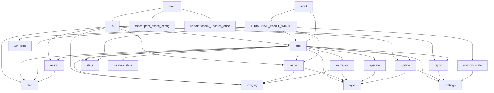

# Architecture map — image-viewer v0.2.12

Baseline snapshot for the systematic entropy-reduction program. Evidence was
collected read-only from the isolated worktree at `C:/tmp/iv-arch`.

## Product snapshot and hard contracts

Windows-first egui/eframe image viewer. Still images and GIF animation are
supported; video playback was removed. Background workers decode images,
thumbnails, GIF frames, Lanczos upscales and release checks. A crash hook writes
a local report and opens a prefilled GitHub issue; the updater stages a verified
exe for the next launch.

Contracts that must not change in a refactoring batch:

- Settings file `%APPDATA%\image-viewer\settings.txt`, `version=1`, tolerant
  `key=value` parsing, forward-compatible `unknown` lines, `.bak` recovery.
- CLI `--print-assoc-config`, `--check-update`, `--stats`, `--no-update`, image path.
- `IV_STARTUP_LOG` and release asset names/SHA256SUMS layout.
- Registry ProgID/Applications/Capabilities layout; UserChoice is read-only.
- External tests/scripts/workflows that consume `--print-assoc-config:exts`.
- No video loading or video association defaults.

## Module responsibilities

| Module | Responsibility | Authority owned |
|---|---|---|
| `src/files.rs` | File-type classification, natural ordering, sibling scan | `SUPPORTED_EXTS`, video rejection, path identity |
| `src/imaging.rs` | Stateless capped decode, EXIF orientation, downscale/rotate | pixel budgets, scale primitive |
| `src/loader.rs` | Current/preload/detail/thumbnail decode queues, LRU cache, retry | `State`, `Role`, `DetailKey`, `FAILED_RETRY`, `CACHE_BUDGET` |
| `src/animation.rs` | Bounded GIF stream with sticky errors | frame queue, frame index/total policy |
| `src/upscale.rs` | One-in-flight Lanczos resample worker | `UpscaleKey`, crop quantization |
| `src/sync.rs` | Poison/panic containment | `LockRecover`, `wait_recover`, `catch_panic` |
| `src/stats.rs` | Bounded F12 latency samples | median/p95 windows |
| `src/settings.rs` | Viewer settings schema, load/save/recovery, window constants | `ViewerSettings`, `KNOWN_KEYS`, path policy |
| `src/window_state.rs` | Viewport restore/tracking/monitor fit | window snapshot validation |
| `src/app.rs` | `ViewerApp` state, lifecycle, startup orchestration | almost all mutable UI state |
| `src/input.rs` | Keyboard and wheel input translation | wheel carry/zoom navigation policy |
| `src/view.rs` | egui panels/dialogs, rendering, thumbnail panel | render geometry, panel interactions |
| `src/assoc*.rs` | Windows/non-Windows association mirrors | ProgID constants, registry operations |
| `src/report.rs` | Crash context, report file, issue URL | crash file and context |
| `src/update.rs` | Release check, verification, staging, swap, status | update filenames, throttle, SHA-256, curl invocation |
| `src/win_icon.rs` | Window icon FFI/no-op | embedded resource id contract |
| `src/main.rs`, `src/lib.rs` | Process entry and crate boundary | CLI dispatch, public re-exports |

## Dependency graph

Unapproved seams: `view -> loader::CACHE_BUDGET`, `input -> view::THUMBNAIL_PANEL_WIDTH`,
`view` deriving detail-region requests from loader budgets, and `app` consuming
`UpscaleKey` internals. These are candidates for boundary hardening, not for
removal unless callers migrate.

## State ownership map

| State group | Owner | Other writers / readers |
|---|---|---|
| `files, index, generation` | `app` | `input` navigates; `view` reads for panels |
| `base, texture, detail_*, upscale_*` | `app` workers | `view` reads geometry and tiles |
| `zoom, fit, rotation, pan_offset, peek_saved` | `app` math | `input` and `view` mutate through helpers |
| `view_rect, view_avail, view_img` | `view` render | `input` wheel zoom reads previous frame geometry |
| `wheel_accum` | `input` | `app` resets on selection |
| `slideshow, slideshow_secs, last_advance` | `app` | `input` ticks; `view` slider mutates |
| `status_msg/status_at/status_ttl` | `app` | `view` reads and sets some messages |
| modal flags, toolbar flags | `app` | `input`, `view` toggle |
| `interval_slider_id` | `view` | `input` reads to suppress shortcuts |
| thumbnail LRU/cache | `view` | `app` clears on folder change |
| loader cache/queues | `loader` worker | `app` submits/polls; `view` reads a constant |
| animation queue | `animation` worker | `app` mirrors frame counters |
| upscale slot | `upscale` worker | `app` constructs keys and consumes results |
| settings | `settings::load/save` | `app::run`, `view` settings window, `window_state` |
| update arcs | `update` worker writes | `app` polls and renders |
| crash context | `report` | `app` sets extension only |
| on-disk update state | `update` | `main --check-update`, installer script |

## Duplication inventory

1. `settings::data_dir` policy re-derived in `report.rs`, `update.rs` and `app.rs`.
2. CLI flags parsed independently in `main.rs` (first arg) and `app.rs` (all args).
3. `assoc.rs` constants/validation duplicated in `assoc_nonwindows.rs`, PS wrappers and Inno script.
4. Installer `image-viewer.iss` still lists video extensions and calls the product a video viewer; `files.rs` rejects them.
5. `SUPPORTED_EXTS` authority duplicated as hardcoded extension lists in `.iss`.
6. Settings test helpers duplicated between `settings_contract.rs` and `settings_stress.rs`.
7. `key=value` config parsing duplicated across four PowerShell scripts and `e2e.rs`.
8. Update asset regex/version parsing duplicated between `update.rs` and `check-update.ps1`.
9. Decode budget math duplicated in `imaging.rs`, `loader.rs` and `animation.rs`.
10. Condvar wait loops duplicated in `loader.rs` and `upscale.rs`; `upscale.rs` bypasses `sync::catch_panic`.
11. Status/help strings duplicated between toolbar tips, settings window and key bindings.
12. README coverage numbers and release asset promises drift from CI and release workflow.

## Technology inventory

- Rust 2021, eframe/egui 0.32, image 0.25, fast_image_resize 6, rfd 0.15.
- Windows-only winreg and raw-window-handle; build.rs embeds icon via winresource.
- PowerShell install/uninstall/association/update/GUI smoke scripts; Inno Setup 6 installer.
- GitHub Actions: PR gates (CI + cross-platform), release, release verification, nightly GUI smoke.
- Tests: Rust unit/integration tests, headless egui harness, PS registry-sandbox tests, ignored performance bench.

## Norm deviations and risks

- Deep UI state object: `ViewerApp` owns unrelated concerns; `app.rs` is 2422 lines.
- Render layer contains business decisions (detail decode, assoc registration, thumbnail eviction).
- `fullscreen` can drift from OS viewport state.
- `upscale` and worker shutdown policies differ from `loader`.
- `curl_program()` falls back to PATH after preferring System32, weakening its stated hijack protection.
- `verify-release.yml` validates only files listed in checksums; unlisted extras pass.
- GUI smoke is nightly-only by design; not a PR gate.

## Deletion-test verdicts

Keep because removal spreads complexity: `State`/`Role` in loader, GIF `Animation`,
`Upscaler`, `LockRecover`/`wait_recover`, settings `unknown` map, `PeekState`,
`WindowSnapshot`, `wheel_accum`, association mirror, PS wrappers, Inno script,
registry guard, `--print-assoc-config` seam, `stage_from_sources` DI seam.

Standardize/remove in early rounds: duplicated data-dir derivation, split CLI
parsing, stale video text/extensions, duplicated settings-test helpers, and
doc/workflow drift.
